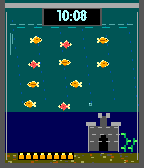

# Fish Tank



A little aquarium on your wrist. Fish cruise through open water above a stone
castle, moving kelp, and a gravel bed. The tank fills a rectangular screen;
round watches get a circular aquarium window.

Count the fish for the local hour, from one to twelve. Warm fish mark AM and
cool fish mark PM on color watches. Tall kelp clumps count minute tens, and the
bright nuggets along the gravel count minute ones. Bubbles rise with the
seconds. The light above the water also shows the exact time in your watch's
12- or 24-hour format.

Tap the watch for six seconds of smoother motion at eight frames per second.
The tank normally updates once per second and pauses animation when another
screen covers it. It runs offline without phone permissions or configuration.

## Watches and build

The project targets Basalt, Chalk, Diorite, Emery, Flint, and Gabbro. Color
watches use Pebble's 64-color palette. Monochrome watches use white fish,
outlined stonework, and a dark tank.

Install Pebble SDK 4.33.1, then run:

```sh
make test
pebble build --sdk 4.33.1
pebble install --emulator basalt build/fish-tank.pbw
```

The host tests need Clang. They check every second of a day, midnight/noon
encodings, 12/24-hour readouts, and fish positions across all school sizes.
`test/emulator.py` uses the Python environment installed with `pebble-tool` to
capture native screens, check natural rollovers, and measure the tap cadence.

```sh
python test/emulator.py basalt --fresh
```

Reports and captures go to `build/evidence/`. Each report records the SHA-256
of the installed package. Emulator results do not measure physical-watch
battery life or daylight readability.

## Source

Luke Steuber created the original
[Fish Tank Screensaver](https://datapoems.io/clocks/fish-tank-screensaver/)
and this native adaptation. Both use the MIT license. The supplied HTML and
its checksum remain in `reference/`.

The native composition retains the local fish, kelp, nugget, and bubble time
mappings. It adds a readable lamp display, keeps every fish within the tank,
and adjusts the composition for each screen shape. The water's daylight tint
uses fixed local hours, 07:00 through 18:59. This offline edition does not fetch
weather or calculate the source's location-based solar lighting.

Barlow Condensed Bold supplies the lamp numerals under the SIL Open Font
License in `resources/fonts/OFL.txt`.
